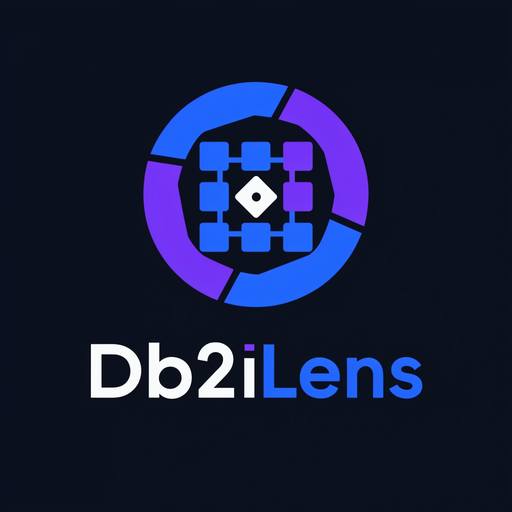
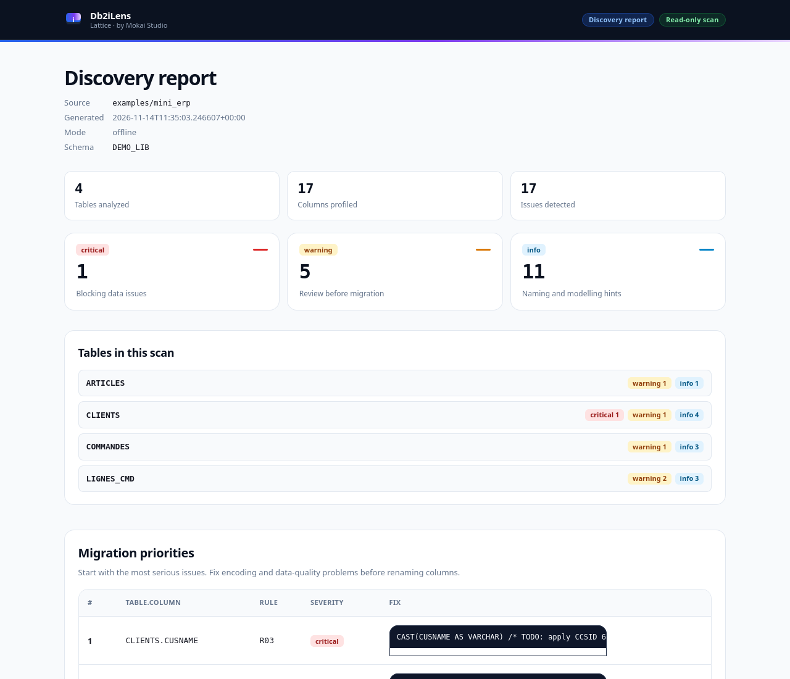

# Db2iLens

> Version [anglaise](README.md) (README principal).

<p align="center">
  
</p>

[](https://github.com/michaelgirardet/db2i-lens/actions/workflows/ci.yml)
[](https://opensource.org/licenses/MIT)
[](https://www.python.org/downloads/)
[](https://github.com/astral-sh/ruff)
[](https://mypy-lang.org/)
[](#)

> **Voyez clairement vos données IBM i**

Outil open source qui profile les données d'un IBM i (AS/400), détecte les pièges legacy (EBCDIC, décimales packées, dates numériques, noms courts) et génère automatiquement le **SQL dbt** de nettoyage pour une migration vers un stack moderne.

> **Statut :** phases **P0–P5** livrées — scan offline + JDBC (JT400), rapports HTML, générateur dbt + `dbt run`/`dbt test` DuckDB, guide PUB400.
> **Backlog :** **P6** (R10, naming LLM, cibles Postgres/Snowflake).

---

## Sommaire

- [Démarrage rapide](#démarrage-rapide)
- [Captures d'écran](#captures-décran)
- [Problème](#problème)
- [MVP (roadmap)](#mvp-roadmap)
- [Installation](#installation-dev)
- [Commandes](#commandes)
- [Démo offline reproductible](#démo-offline-reproductible)
- [Essayer sur PUB400](#essayer-sur-pub400)
- [Structure](#structure)
- [Développement](#développement)
- [Licence](#licence)

---

## Démarrage rapide

**Tester Db2iLens en 3 commandes, sans IBM i :**

```bash
# 1. Cloner et installer
uv sync

# 2. Scanner le mini-ERP de démo (offline)
uv run db2ilens scan --offline examples/mini_erp/ --out /tmp/scan.yaml

# 3. Générer le rapport HTML
uv run db2ilens report /tmp/scan.yaml --format html --out /tmp/report.html
```

Le rapport (`/tmp/report.html`) analyse les 4 tables du mini-ERP avec **8+ pièges legacy** détectés.

---

## Captures d'écran

### Rapport de découverte HTML



*Exemple généré depuis le mini-ERP (`CLIENTS`, `COMMANDES`, `LIGNES_CMD`, `ARTICLES`). Un snapshot complet est versionné dans [`demo-report.html`](demo-report.html) et peut être régénéré via la [démo offline](#démo-offline-reproductible).*

### Logo


*Logo Db2iLens — marque lens / lattice (bleu `#2563EB`, violet `#7C3AED`). Variantes SVG dans `docs/assets/`.*

---

## Problème

Les migrations AS/400 → cloud **échouent souvent sur les quirks des données** (dates `YYYYMMDD`, CCSID 65535, blancs au lieu de NULL, colonnes à 10 caractères), **pas sur la connexion elle-même**.

---

## MVP (roadmap)

| Phase | Contenu | Statut |
|-------|---------|--------|
| **P0** | Squelette repo, CLI, `Rule`, fixtures mini-ERP, CI | ✅ |
| **P1** | Connector offline + profiling + R01, R05, R08 + `scan --offline` | ✅ |
| **P2** | Règles R02–R04, R06, R07 + dictionnaire d'abréviations | ✅ |
| **P3** | Rapports Markdown/HTML + contrat `scan.yaml` stable | ✅ |
| **P4** | Générateur dbt + e2e DuckDB | ✅ |
| **P5** | Connector JDBC JT400 + guide PUB400 | ✅ |
| **P6** | Relations R10, naming LLM, Postgres/Snowflake (backlog) | ⏳ |

---

## Installation (dev)

```bash
uv sync
./scripts/fetch_jt400.sh   # JDBC uniquement — voir docs/JT400.md
uv run db2ilens --help
```

---

## Commandes

```bash
# Scan (offline)
db2ilens scan --offline examples/mini_erp/ --out scan.yaml

# Scan (IBM i / PUB400 — bibliothèque personnelle + filtre MLENS_)
export JT400_JAR=$HOME/.db2ilens/jt400.jar
export DB2ILENS_PASSWORD='...'
db2ilens scan --host pub400.com --user YOUR_USER --schema YOUR_LIBRARY \
  --tables MLENS_% --out scan.yaml

# Rapport de découverte (Markdown / HTML)
db2ilens report scan.yaml --format html --out report.html

# Projet dbt (bronze/silver)
db2ilens gen-dbt scan.yaml --out dbt_project/ --target duckdb
```

> **⚠️ Sécurité :** le mot de passe IBM i passe **uniquement** via `--password-stdin` ou la variable `DB2ILENS_PASSWORD` (jamais en argument CLI ni en fichier).

---

## Démo offline reproductible

Pour régénérer un rapport HTML depuis le mini-ERP (sans IBM i) :

```bash
uv run db2ilens scan --offline examples/mini_erp/ --out /tmp/scan_mini_erp.yaml
# Optionnel pour un snapshot public : réécrire scan.source en chemin relatif
# (le scan offline stocke un chemin absolu par design — voir docs/assets/README.md)
uv run db2ilens report /tmp/scan_mini_erp.yaml --format html --out /tmp/report_mini_erp.html
```

Snapshot versionné : [`demo-report.html`](demo-report.html).
*Snapshot illustratif — à régénérer après changement de fixtures ou du rendu HTML.*

---

## Essayer sur PUB400

1. **Compte :** [pub400.com](https://pub400.com) (activation parfois différée de quelques heures).
2. **Driver :** Java 11+ et `./scripts/fetch_jt400.sh` (détails dans [docs/JT400.md](docs/JT400.md)).
3. **Bibliothèque personnelle :** les comptes gratuits **ne peuvent pas** `CREATE SCHEMA`. Chaque utilisateur a déjà une bibliothèque personnelle (souvent = profil en majuscules). Elle peut contenir d'autres objets — d'où le préfixe `MLENS_` et le filtre `--tables MLENS_%`.
4. **Charger le mini-ERP :** éditez [`examples/mini_erp/pub400_setup.sql`](examples/mini_erp/pub400_setup.sql), remplacez `YOUR_LIBRARY`, exécutez dans ACS *Run SQL Scripts*.
5. **Vérifs ACS** (remplacez `YOUR_LIBRARY`) :
   ```sql
   SELECT COUNT(*) FROM YOUR_LIBRARY.MLENS_COMMANDES;  -- 5
   SELECT CCSID FROM QSYS2.SYSCOLUMNS2
     WHERE TABLE_SCHEMA = 'YOUR_LIBRARY'
       AND TABLE_NAME = 'MLENS_CLIENTS'
       AND COLUMN_NAME = 'CUSNAME';  -- 65535
   ```
6. **Scan + rapport + dbt :**
   ```bash
   export JT400_JAR=$HOME/.db2ilens/jt400.jar
   export DB2ILENS_USER=YOUR_USER
   export DB2ILENS_PASSWORD='...'
   export PUB400_SCHEMA=YOUR_LIBRARY
   export PUB400_TABLES=MLENS_%

   uv run db2ilens scan --host pub400.com --user "$DB2ILENS_USER" \
     --schema "$PUB400_SCHEMA" --tables "$PUB400_TABLES" \
     --out /tmp/scan_pub400.yaml
   uv run db2ilens report /tmp/scan_pub400.yaml --format html --out /tmp/report.html
   uv run db2ilens gen-dbt /tmp/scan_pub400.yaml --out /tmp/dbt_pub400 --target duckdb
   ```
7. **Limites PUB400 :** quota CPU/connexion, première session JT400 parfois lente, bibliothèques en **majuscules**.
   **Note R04 :** (`implied_scale` sur `PRC`) — *échelle décimale implicite déclarée au schéma, invisible dans SYSCOLUMNS2* — attendu **absent** en JDBC, présent en offline (divergence documentée pour la parité #18).

**Tests live (hors CI) :**
```bash
export PUB400_TABLES=MLENS_%
uv run pytest -m integration
```

---

## Structure

```text
src/db2ilens/
├── cli.py
├── connector/     # JDBC + offline
├── profiler/      # métadonnées + échantillonnage
├── rules/         # détection des pièges legacy
├── report/        # Markdown / HTML
├── scan.py        # contrat scan.yaml
└── dbtgen/        # templates Jinja2 → projet dbt
```

---

## Développement

Voir :
- [CONTRIBUTING.md](CONTRIBUTING.md) — contribution
- [AGENTS.md](AGENTS.md) — règles du projet
- [docs/SCAN_CONTRACT.md](docs/SCAN_CONTRACT.md) — contrat `scan.yaml`
- [CHANGELOG.md](CHANGELOG.md) — releases et table des règles

```bash
uv run ruff check .
uv run mypy src
uv run pytest                 # exclut @pytest.mark.integration
uv run pytest -m integration  # PUB400 live
```

---

## Licence

MIT — voir [LICENSE](LICENSE).
