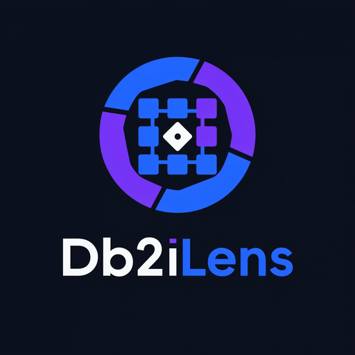
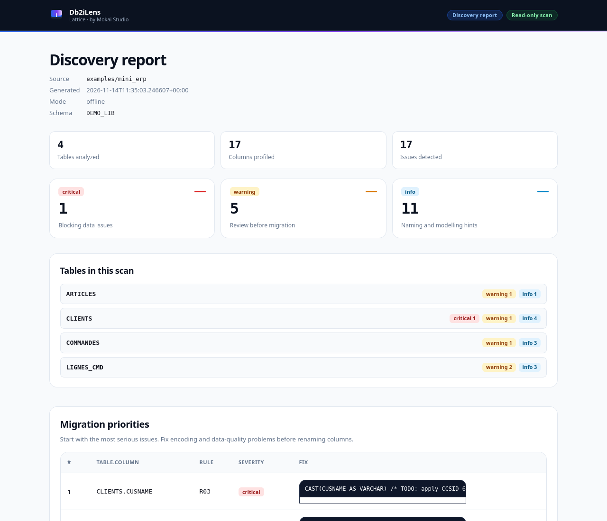

# Db2iLens

> Also available in [French](README.fr.md).

<p align="center">
  
</p>

[](https://github.com/michaelgirardet/db2i-lens/actions/workflows/ci.yml)
[](https://opensource.org/licenses/MIT)
[](https://www.python.org/downloads/)
[](https://github.com/astral-sh/ruff)
[](https://mypy-lang.org/)
[](#)

> **See your IBM i data clearly**

Open-source tool that profiles IBM i (AS/400) data, detects legacy pitfalls (EBCDIC, packed decimals, numeric dates, short names) and automatically generates **dbt SQL** for cleaning during migration to a modern stack.

> **Status:** phases **P0-P5** delivered - offline scan + JDBC (JT400), HTML reports, dbt project generator + `dbt run`/`dbt test` with DuckDB, PUB400 guide.
> **Backlog:** **P6** (R10, LLM naming, Postgres/Snowflake targets).

---

## Table of Contents

- [Quickstart](#quickstart)
- [Screenshots](#screenshots)
- [Problem](#problem)
- [MVP (Roadmap)](#mvp-roadmap)
- [Installation](#installation-dev)
- [Commands](#commands)
- [Reproducible Offline Demo Path](#reproducible-offline-demo-path)
- [Try it on PUB400](#try-it-on-pub400)
- [Structure](#structure)
- [Development](#development)
- [License](#license)

---

## Quickstart

**Try Db2iLens in 3 commands without IBM i:**

```bash
# 1. Clone and install
uv sync

# 2. Scan the demo mini-ERP (offline)
uv run db2ilens scan --offline examples/mini_erp/ --out /tmp/scan.yaml

# 3. Generate HTML report
uv run db2ilens report /tmp/scan.yaml --format html --out /tmp/report.html
```

The generated report (`/tmp/report.html`) contains the complete analysis of the 4 tables in the mini-ERP with **8+ detected legacy pitfalls**.

---

## Screenshots

### HTML Discovery Report



*Example report from the mini-ERP (`CLIENTS`, `COMMANDES`, `LIGNES_CMD`, `ARTICLES`). A full snapshot is committed as [`demo-report.html`](demo-report.html) and can be regenerated with the [offline demo path](#reproducible-offline-demo-path).*

### Logo


*Db2iLens logo — lens / lattice mark in Lattice brand colors (system blue `#2563EB`, violet `#7C3AED`). SVG variants remain in `docs/assets/`.*

---

## Problem

AS/400 to cloud migrations **often fail on data quirks** (YYYYMMDD dates, CCSID 65535, blanks instead of NULL, 10-character columns), **not on connectivity itself**.

---

## MVP (Roadmap)

| Phase | Content | Status |
|-------|---------|--------|
| **P0** | Repository skeleton, CLI, `Rule`, mini-ERP fixtures, CI | ✅ |
| **P1** | Offline connector + profiling + R01, R05, R08 + `scan --offline` | ✅ |
| **P2** | Rules R02-R04, R06, R07 + abbreviation dictionary | ✅ |
| **P3** | Markdown/HTML reports + stable `scan.yaml` contract | ✅ |
| **P4** | dbt project generator + e2e testing with DuckDB | ✅ |
| **P5** | JT400 JDBC connector + PUB400 integration guide | ✅ |
| **P6** | R10 relationships, LLM naming, Postgres/Snowflake targets (backlog) | ⏳ |

---

## Installation (dev)

```bash
uv sync
./scripts/fetch_jt400.sh   # JDBC only - see docs/JT400.md
uv run db2ilens --help
```

---

## Commands

```bash
# Scan (offline)
db2ilens scan --offline examples/mini_erp/ --out scan.yaml

# Scan (IBM i / PUB400 - personal library + MLENS_ filter)
export JT400_JAR=$HOME/.db2ilens/jt400.jar
export DB2ILENS_PASSWORD='...'
db2ilens scan --host pub400.com --user YOUR_USER --schema YOUR_LIBRARY \
  --tables MLENS_% --out scan.yaml

# Discovery report (Markdown / HTML)
db2ilens report scan.yaml --format html --out report.html

# dbt project (bronze/silver)
db2ilens gen-dbt scan.yaml --out dbt_project/ --target duckdb
```

> **⚠️ Security:** IBM i passwords are passed **only** via `--password-stdin` or `DB2ILENS_PASSWORD` environment variable (never as CLI argument or in files).

---

## Reproducible Offline Demo Path

To regenerate an HTML report from the mini-ERP (without IBM i):

```bash
uv run db2ilens scan --offline examples/mini_erp/ --out /tmp/scan_mini_erp.yaml
# Optional for a public-facing snapshot: rewrite scan.source to a relative path
# (offline scans store an absolute path by design — see docs/assets/README.md)
uv run db2ilens report /tmp/scan_mini_erp.yaml --format html --out /tmp/report_mini_erp.html
```

Committed demo snapshot: [`demo-report.html`](demo-report.html).
*Illustrative snapshot — regenerate after fixture changes or report renderer modifications.*

---

## Try it on PUB400

1. **Account:** [pub400.com](https://pub400.com) (activation may be delayed by a few hours).
2. **Driver:** Java 11+ and `./scripts/fetch_jt400.sh` (details in [docs/JT400.md](docs/JT400.md)).
3. **Personal Library:** Free accounts **cannot** `CREATE SCHEMA`. Each user already has a personal library (often = user profile in uppercase). It may contain other objects - hence the `MLENS_` prefix on demo tables and the `--tables MLENS_%` filter.
4. **Load the mini-ERP:** Edit [`examples/mini_erp/pub400_setup.sql`](examples/mini_erp/pub400_setup.sql), replace `YOUR_LIBRARY` with your library, run the script in ACS *Run SQL Scripts*.
5. **ACS Checks** (replace `YOUR_LIBRARY`):
   ```sql
   SELECT COUNT(*) FROM YOUR_LIBRARY.MLENS_COMMANDES;  -- 5
   SELECT CCSID FROM QSYS2.SYSCOLUMNS2
     WHERE TABLE_SCHEMA = 'YOUR_LIBRARY'
       AND TABLE_NAME = 'MLENS_CLIENTS'
       AND COLUMN_NAME = 'CUSNAME';  -- 65535
   ```
6. **Scan + report + dbt:**
   ```bash
   export JT400_JAR=$HOME/.db2ilens/jt400.jar
   export DB2ILENS_USER=YOUR_USER
   export DB2ILENS_PASSWORD='...'
   export PUB400_SCHEMA=YOUR_LIBRARY   # personal library
   export PUB400_TABLES=MLENS_%        # integration tests + demo filter

   uv run db2ilens scan --host pub400.com --user "$DB2ILENS_USER" \
     --schema "$PUB400_SCHEMA" --tables "$PUB400_TABLES" \
     --out /tmp/scan_pub400.yaml
   uv run db2ilens report /tmp/scan_pub400.yaml --format html --out /tmp/report.html
   uv run db2ilens gen-dbt /tmp/scan_pub400.yaml --out /tmp/dbt_pub400 --target duckdb
   ```
7. **PUB400 Limits:** CPU/connection quota, first JT400 session sometimes slow, libraries in **uppercase**.
   **R04 note:** (`implied_scale` on `PRC`): *implicit decimal scale is a schema-level declaration, invisible in SYSCOLUMNS2* - expected **absent** in JDBC, present in offline mode (documented divergence for parity #18).

**Live tests (outside CI):**
```bash
export PUB400_TABLES=MLENS_%
uv run pytest -m integration
```

---

## Structure

```text
src/db2ilens/
├── cli.py
├── connector/     # JDBC + offline connectors
├── profiler/      # metadata + sampling
├── rules/         # legacy pitfalls detection
├── report/        # Markdown / HTML renderers
├── scan.py        # scan.yaml contract & validation
└── dbtgen/        # Jinja2 templates -> dbt project
```

---

## Development

See:
- [CONTRIBUTING.md](CONTRIBUTING.md) — contribution guidelines
- [AGENTS.md](AGENTS.md) — project rules
- [docs/SCAN_CONTRACT.md](docs/SCAN_CONTRACT.md) — stable `scan.yaml` contract
- [CHANGELOG.md](CHANGELOG.md) — releases and detection rules table

```bash
uv run ruff check .          # Linting
uv run mypy src              # Strict type checking
uv run pytest                 # Excludes @pytest.mark.integration
uv run pytest -m integration  # PUB400 live tests
```

---

## License

MIT - see [LICENSE](LICENSE).
