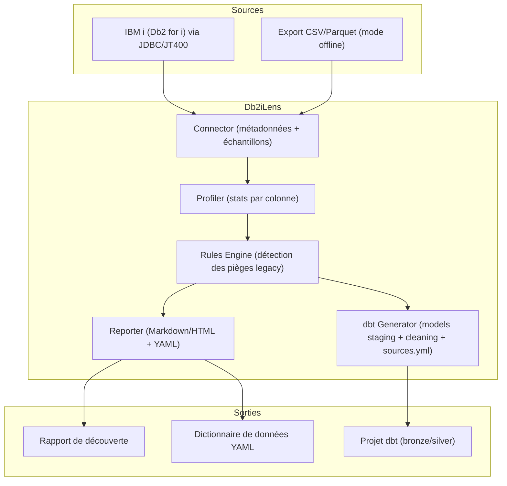

# Db2iLens — Dossier de cadrage produit

> Outil open source qui profile les données d'un IBM i (AS/400), détecte les pièges legacy (EBCDIC, décimales packées, dates numériques, noms courts) et génère automatiquement le SQL dbt de nettoyage pour une migration vers un stack moderne.

---

## 1. Vision et problème

**Problème.** Des milliers d'entreprises (manufacturing, distribution, finance) gardent leur ERP sur IBM i. Toute migration ou projet data moderne commence par extraire et comprendre ces données, or :

- Personne ne sait ce que contiennent les tables (noms de colonnes à 10 caractères, sans documentation).
- Chaque équipe redécouvre les mêmes pièges : dates numériques (`20261111`), décimales packées, texte EBCDIC (CCSID 65535), blancs au lieu de NULL, colonnes multi-valeurs.
- Les projets échouent sur les "quirks", pas sur la connexion ([Sigma](https://www.usesigma.co/company/blog/as400-ibm-i-data-to-modern-data-warehouse)).

**Solution.** Un CLI Python qui se connecte en JDBC à l'IBM i (ou lit un export), profile chaque table, produit un **rapport de découverte** lisible et un **projet dbt prêt à l'emploi** qui nettoie les données vers des schémas modernes (bronze → silver).

**Référence marché.** Les équivalents propriétaires (Precisely, Qlik, Informatica) coûtent des dizaines de milliers d'euros. Aucun outil open source simple ne couvre "scan → rapport → dbt généré".

---

## 2. Périmètre

### Objectifs du MVP
1. Connexion JDBC à Db2 for i (driver JT400), avec alternative "fichier Parquet/CSV" pour tests hors ligne.
2. Profilage des métadonnées : tables, colonnes, types, nullabilité (via `QSYS2.SYSCOLUMNS2`).
3. Profilage d'échantillons de données : stats par colonne (distinct, min/max, top valeurs).
4. Moteur de règles détectant les pièges legacy (voir catalogue section 5).
5. Génération de : rapport Markdown/HTML + projet dbt (models staging + cleaning) + fichier YAML `sources`.
6. Détecteur de dates numériques avec inférence de format (`YYYYMMDD`, `DDMMYYYY`, `CYYMMDD` IBM).

### Non-goals (v1)
- Pas de CDC / streaming (Debezium reste un projet séparé).
- Pas de réécriture de code RPG/CL.
- Pas de modification de la source (outil en lecture seule, aucun DML sur l'AS/400).
- Pas d'UI web (CLI + rapport statique suffisent).

### Utilisateurs cibles
- Ingénieurs data en mission de migration AS/400 → cloud.
- Développeurs IBM i curieux de moderniser.
- Consultants qui doivent livrer un "data discovery" rapide à un client.

---

## 3. Architecture



**Principe clé : lecture seule.** L'outil n'exécute que des `SELECT` et des requêtes sur les catalogues système (`QSYS2.SYSCOLUMNS2`, `SYSTABLES`, `SYSPARTITIONSTATS`).

---

## 4. Stack technique et structure du repo

**Stack** : Python 3.11+, JayDeBeApi + JT400 (JDBC), pandas (échantillons), Jinja2 (génération dbt/rapport), PyYAML, click (CLI), pytest. Packaging : `uv` + `pyproject.toml`. Qualité : ruff, mypy.

```text
db2ilens/
├── pyproject.toml
├── README.md
├── AGENTS.md                  # règles pour l'agent IA (Cursor / Vibe)
├── .cursorrules               # alias vers AGENTS.md pour Cursor
├── docs/
│   └── PRD.md                 # dossier de cadrage (ce document)
├── src/db2ilens/
│   ├── cli.py                 # CLI click : `db2ilens scan`, `db2ilens report`, `db2ilens gen-dbt`
│   ├── connector/
│   │   ├── ibmi_jdbc.py       # connexion + requêtes catalogue système
│   │   └── offline.py         # source CSV/Parquet pour tests
│   ├── profiler/
│   │   ├── metadata.py        # tables, colonnes, types, nullabilité
│   │   └── sampling.py        # échantillonnage stats par colonne
│   ├── rules/
│   │   ├── base.py            # interface Rule (nom, sévérité, detect(), fix())
│   │   ├── date_rules.py      # dates numériques, CYYMMDD
│   │   ├── encoding_rules.py  # CCSID 65535, chars de contrôle
│   │   ├── numeric_rules.py   # packed decimal, 99999999, zéros signifiants
│   │   └── naming_rules.py    # noms 10 caractères, abréviations courantes
│   ├── report/
│   │   ├── markdown.py
│   │   └── html.py
│   └── dbtgen/
│       ├── templates/         # templates Jinja2 (staging.sql, cleaning.sql, sources.yml, dbt_project.yml)
│       └── generator.py
├── tests/
│   ├── fixtures/              # mini-ERP de test (DDL + données)
│   └── ...
└── examples/
    └── mini_erp/              # démo PUB400 : DDL + script de chargement
```

---

## 5. Catalogue des règles de détection (v1)

Chaque règle a : un ID, une sévérité (info / warning / critical), une méthode `detect()` (requêtes sur échantillon) et une `fix()` (SQL dbt généré).

| ID | Règle | Détection | Fix dbt généré |
|---|---|---|---|
| R01 | Date numérique DEC(8,0) | colonne numérique, 100% des valeurs matchent `YYYYMMDD` valide | `TO_DATE(TO_CHAR(col), 'YYYYMMDD')` |
| R02 | Date IBM CYYMMDD DEC(7,0) | valeurs 7 chiffres commençant par 0-1, format 20{1,2}... | `DATE('19'\|\|...)` logique siècle |
| R03 | CCSID 65535 (EBCDIC binaire) | `CCSID 65535` dans SYSCOLUMNS2, ou caractères de contrôle dans échantillon | cast + mapping table de traduction |
| R04 | Décimale packée implicite | DEC stocké sans point, colonne type implicite | division par 10^d + CAST |
| R05 | Blancs = NULL | chaînes vides/blanches fréquentes sur colonne not null logique | `NULLIF(TRIM(col), '')` |
| R06 | Nom 10 caractères obscur | nom de colonne ≤ 10 chars + pas de commentaire | nom long suggéré (dictionnaire d'abréviations + LLM optionnel) |
| R07 | Colonne multi-valeurs | valeurs contenant un séparateur récurrent (`,` `;` `\|`) | split + table enfant (v1: warning seulement) |
| R08 | Drapeaux 'Y'/'N' ou '1'/'0' | cardinalité = 2 sur colonne char(1) | cast boolean |
| R09 | Zéro sentinelle | 0 fréquent sur colonne qui devrait être nullable | `NULLIF(col, 0)` avec confirmation humaine |
| R10 | Détection de relations implicites | même nom de colonne (ex. CUSID) dans plusieurs tables | annotation `relationships` dbt dans YAML |

Le dictionnaire d'abréviations (`CST` → customer, `ORD` → order, `DTE` → date, etc.) est embarqué dans `naming_rules.py` et enrichissable via un YAML.

---

## 6. Spécification CLI

```bash
# Scanner un IBM i (une seule passe, résultats en JSON/YAML)
db2ilens scan --host pub400.com --user MONUSER --schema DEMO_LIB \
              --password-stdin --sample-rows 5000 --out scan.yaml

# Mode offline (pour tests et démo sans AS/400)
db2ilens scan --offline examples/mini_erp/ --out scan.yaml

# Générer le rapport de découverte
db2ilens report scan.yaml --format html --out rapport.html

# Générer le projet dbt
db2ilens gen-dbt scan.yaml --out dbt_project/ --target duckdb
```

Le mot de passe passe par `--password-stdin` ou variable d'env `DB2ILENS_PASSWORD`, jamais en argument ni en fichier.

**Format de sortie `scan.yaml`** : par table → métadonnées, stats par colonne, liste des règles déclenchées avec sévérité, suggestions de fix. C'est l'artifact central : une seule passe sur la source, tout le reste (rapport, dbt) se génère depuis ce fichier.

---

## 7. Projet dbt généré (architecture médaillon)

```text
dbt_project/
├── dbt_project.yml
├── profiles.yml.example      # duckdb (dev) / snowflake (prod)
├── models/
│   ├── staging/              # 1 model par table source, types bruts
│   │   ├── stg_customers.sql
│   │   └── ...
│   └── marts/                # nettoyage appliqué selon les règles détectées
│       ├── customers.sql     # dates converties, bool castés, noms longs
│       └── ...
└── sources.yml               # déclarations + relations implicites détectées
```

Chaque model staging porte un commentaire en tête listant les règles détectées, et chaque model mart référence les tests dbt générés (`not_null`, `accepted_values`, `relationships`) selon ce qui a été trouvé.

---

## 8. Stratégie de tests

1. **Fixtures offline** : un mini-ERP fictif (CLIENTS, COMMANDES, LIGNES_CMD, ARTICLES) contenant volontairement tous les pièges du catalogue. Tests unitaires : chaque règle détecte ce qu'elle doit.
2. **Tests bout en bout** : `scan --offline → report → gen-dbt` puis `dbt run + dbt test` sur DuckDB dans la CI (GitHub Actions).
3. **Test d'intégration PUB400** (manuel, hors CI) : compte gratuit, bibliothèque privée, jeu de données du mini-ERP chargé via le DDL d'exemple.

---

## 9. Roadmap

| Phase | Contenu | Durée indicative |
|---|---|---|
| P0 | Squelette repo, CLI vide, CI, AGENTS.md, fixtures mini-ERP | 2-3 j |
| P1 | Connector offline + metadata + sampling + règles R01, R05, R08 | 1 sem |
| P2 | Règles R02-R04, R06 + dictionnaire d'abréviations | 1 sem |
| P3 | Rapport Markdown puis HTML + scan.yaml stable | 3-4 j |
| P4 | Générateur dbt + templates + e2e dbt sur DuckDB | 1-2 sem |
| P5 | Connector JDBC JT400 réel + doc PUB400 + README démo | 3-4 j |
| P6 (post-MVP) | Relations implicites R10, heuristique LLM de nommage, support Postgres/Snowflake | backlog |

Ordre choisi pour que chaque phase livrée reste utile et testable sans accès AS/400 (P5 arrive tard à dessein : le mode offline rend le développement possible partout).

---

## 10. Guide de développement avec Cursor ou Vibe

### 10.1 Fichier AGENTS.md (à créer à la racine du repo)

```markdown
# Règles du projet Db2iLens

## Contexte
Outil Python en lecture seule qui profile des données IBM i et génère du dbt.
L'utilisateur travaille en français ou anglais ; le code et les identifiants sont en anglais.

## Conventions
- Python 3.11+, typing strict (mypy), formatage ruff, tests pytest obligatoires.
- Tout accès DB passe par src/db2ilens/connector/. Aucun SQL en dehors.
- Aucune requête ne doit modifier la source : SELECT uniquement, jamais de DML/DDL.
- Chaque règle de détection hérite de rules/base.py::Rule (id, sévérité, detect, fix).
- Les mots de passe ne sont jamais écrits dans le code, les logs ou les fichiers de test.
- Les templates dbt sont en Jinja2 dans db2ilens/dbtgen/templates/, jamais de SQL en dur dans le Python.

## Avant de terminer une tâche
1. `ruff check . && mypy src && pytest` passent.
2. Toute nouvelle règle vient avec un fixture la déclenchant et un test.
3. Toute nouvelle commande CLI vient avec un test e2e en mode offline.
```

Pour Cursor, `.cursorrules` contient juste : `Read and follow AGENTS.md.`

### 10.2 Bonnes pratiques avec l'agent IA

- **Une phase à la fois** : donner la roadmap comme unique plan directeur et demander "implémente la phase P1, item par item, en respectant AGENTS.md".
- **Toujours tester en mode offline d'abord** : le JDBC réel ne sert qu'à la validation finale (P5).
- **Générer les fixtures tôt** : demander explicitement le mini-ERP complet avec tous les pièges avant d'écrire les règles, pour que les tests pilotent le code.
- **Relire le SQL généré** : le SQL dbt produit doit être revu manuellement une fois par modèle ; c'est la valeur cœur du projet.

### 10.3 Prompt de démarrage (à coller dans Cursor ou Vibe)

> Lis AGENTS.md et la roadmap du README. Initialise le projet selon la structure définie dans la documentation (pyproject avec uv, click, jaydebeapi, jinja2, pandas, pyyaml, pytest, ruff, mypy). Crée le squelette CLI avec les commandes `scan`, `report`, `gen-dbt` vides mais fonctionnelles (help), la classe de base `Rule`, et le mini-ERP de fixtures contenant les pièges R01 à R08. Ajoute la CI GitHub Actions qui lance ruff, mypy et pytest. Ne touche à rien d'autre.

---

## 11. Critères d'acceptation du MVP

1. `db2ilens scan --offline` sur le mini-ERP détecte au moins les règles R01, R02, R05, R06, R08 avec zéro faux positif.
2. `db2ilens report` produit un rapport HTML lisible par un non-technicien.
3. `db2ilens gen-dbt` produit un projet dbt qui passe `dbt run && dbt test` sur DuckDB sans modification manuelle.
4. La connexion JDBC réelle fonctionne sur PUB400 avec un compte gratuit (documentée pas à pas dans le README).
5. README avec démo GIF/vidéo, badge CI, licence MIT.
